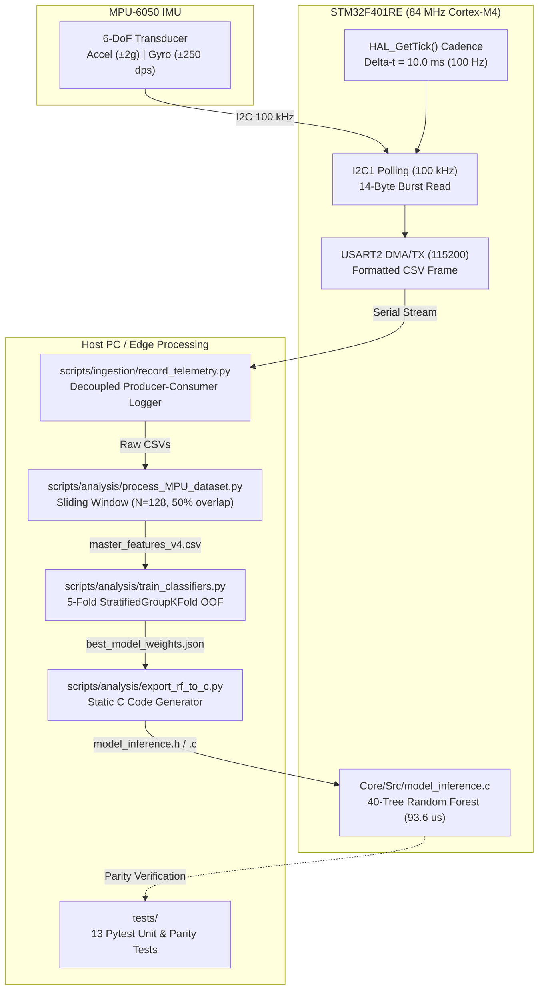

# Monsoon Sentinel: System Instruction Booklet & Operational Guide

> **Monsoon Sentinel: Autonomous Embedded Telemetry & Edge Machine Learning Kinematic Regime Classifier**  
> *Target Hardware*: STMicroelectronics STM32F401RE Nucleo-64 (ARM Cortex-M4 @ 84\,MHz, Hardware FPU, 512\,KB Flash, 96\,KB SRAM)  
> *Sensor*: InvenSense MPU-6050 6-DoF Inertial Measurement Unit (I2C1 @ 100\,kHz Standard Mode)  
> *Host Environment*: Linux x86_64, GCC ARM Embedded Toolchain (`arm-none-eabi-gcc`), Python 3.13 (`ML` environment)

---

## 1. Executive Summary & System Architecture

**Monsoon Sentinel** is a dual-project embedded system designed for structural health monitoring (SHM) and coastal mast/cantilever kinetic regime detection under severe environmental conditions (monsoon winds, cyclonic buffeting, wave swell, and physical impacts).

The architecture is divided into two operational halves:
1. **Part 1 (Embedded Ingestion & Physical Telemetry)**: Deterministic 100\,Hz IMU sampling on STM32F401RE, low-overhead serial streaming, host ingestion with frozen-frame detection, sliding-window calibration, and time/frequency feature engineering.
2. **Part 2 (Edge DSP & Machine Learning Classification)**: 128-point CMSIS-DSP real FFT (`arm_rfft_fast_f32`), spectral band energy integration, and an embedded 40-tree Random Forest inference engine compiled directly to static C conditional branches with zero heap allocations.



---

## 2. Repository Layout & File Catalog

```
monsoon-sentinel/
├── Core/
│   ├── Inc/
│   │   ├── main.h                      # Peripheral macros, pin definitions, function prototypes
│   │   ├── model_inference.h           # Feature and class enums, C inference prototypes
│   │   ├── stm32f4xx_hal_conf.h        # HAL module selection (I2C, UART, RCC, Flash, DMA)
│   │   └── stm32f4xx_it.h              # Interrupt service routine header
│   └── Src/
│       ├── main.c                      # Firmware entrypoint, clock config (84 MHz), 100 Hz timing loop
│       ├── model_inference.c           # Static C implementation of 40 decision trees + Z-score scaler
│       ├── stm32f4xx_hal_msp.c         # MCU support package (GPIO pin muxing for I2C1 and USART2)
│       ├── stm32f4xx_it.c              # SysTick handler and peripheral ISRs
│       ├── syscalls.c                  # POSIX low-level stubs (minimal libc support)
│       ├── sysmem.c                    # Heap allocation stub (_sbrk)
│       └── system_stm32f4xx.c          # CMSIS system initialization (SystemCoreClock update)
├── Drivers/
│   ├── CMSIS/                          # ARM Cortex-M CMSIS core & DSP headers and source files
│   │   └── DSP/Lib/GCC/
│   │       └── libarm_cortexM4lf_math.a # Compiled Cortex-M4 Hard-FPU CMSIS-DSP library archive
│   └── STM32F4xx_HAL_Driver/          # STMicroelectronics hardware abstraction layer sources
├── data/
│   ├── raw/                            # Raw IMU CSV logs (excluded from Git to maintain repo hygiene)
│   └── processed/
│       ├── best_model_weights.json     # Trained 40-tree Random Forest weights and scaler (Option A)
│       ├── best_model_weights_option_b.json # Trained Edge MLP weights and scaler (Option B)
│       └── master_features_v4.csv      # Processed feature matrix (excluded from Git; generated by pipeline)
├── scripts/
│   ├── ingestion/
│   │   └── record_telemetry.py         # Multi-threaded serial logger with freeze frame detection
│   └── analysis/
│       ├── export_rf_to_c.py           # Auto-generates Core/Inc/model_inference.h and Core/Src/model_inference.c
│       ├── train_classifiers.py        # 5-fold StratifiedGroupKFold ML benchmark suite (4-class and 3-class)
│       ├── process_MPU_dataset.py      # Feature engineering pipeline (N=128 windowing, time & FFT features)
│       ├── generate_report_tables.py   # Generates LaTeX Tables I, II, III for Part 1 report
│       ├── generate_part2_tables.py    # Generates LaTeX hardware profile & confusion matrix for Part 2 report
│       ├── eda_plots_code.py           # Generates 300 DPI exploratory data analysis figures
│       └── record_baseline.py          # Legacy single-threaded serial recording script
├── tests/
│   ├── test_part1_telemetry_pipeline.py# 12 formal pytest unit tests (sampling, jitter, Nyquist, Parseval)
│   └── test_c_model_parity.py          # Standalone GCC test asserting 100% parity between C and Python RF
├── reports/
│   ├── figures/                        # High-resolution (300 DPI) publication-grade figures
│   │   ├── eda_scatter_separability.png
│   │   ├── eda_boxplots_distributions.png
│   │   ├── eda_feature_correlation.png
│   │   └── model_benchmark_confusion_matrices.png
│   ├── part1_telemetry/                # Part 1 LaTeX table exports
│   │   ├── table_dataset_registry.tex
│   │   ├── table_feature_summary.tex
│   │   └── table_timing_budget.tex
│   └── part2_classifier/              # Part 2 LaTeX table exports
│       ├── table_model_benchmarks.tex
│       ├── table_hardware_profile.tex
│       └── table_confusion_matrix.tex
├── Makefile                            # GNU Make build recipe with CMSIS-DSP & model_inference linking
├── STM32F401XX_FLASH.ld                # Linker memory map (512 KB Flash, 96 KB SRAM)
├── startup_stm32f401xe.s               # Cortex-M4 vector table and startup code
├── report.pdf / report.tex             # Part 1 formal IEEE research paper
├── report_part2.pdf / report_part2.tex # Part 2 formal IEEE research paper
├── presentation.pdf / presentation.tex # Summary slide deck for academic/industrial presentation
├── INSTRUCTION_BOOKLET.md              # This instruction guide
└── .gitignore                          # Excludes raw data, CSVs, build dumps, and LaTeX auxiliary files
```

---

## 3. Detailed Component Catalog

### 3.1 Firmware Implementation Files

#### `Core/Src/main.c` & `Core/Inc/main.h`
- **Purpose**: Primary STM32 firmware loop.
- **Hardware Configuration**:
  - System Clock: 84\,MHz generated via High-Speed Internal (HSI 16\,MHz) oscillator fed into PLL ($M=16, N=336, P=4$).
  - Bus Dividers: APB1 Prescaler = 2 ($f_{\text{APB1}} = 42\,\text{MHz}$), APB2 Prescaler = 1 ($f_{\text{APB2}} = 84\,\text{MHz}$).
  - I2C1: Standard Mode 100\,kHz on PB8 (SCL) and PB9 (SDA).
  - USART2: Asynchronous 115,200 baud, 8 data bits, no parity, 1 stop bit on PA2 (TX) and PA3 (RX).
- **Execution Mechanism**:
  - Implements deterministic 100\,Hz cadence ($10.0\,\text{ms}$) via non-blocking `HAL_GetTick()` delta checking: `if (HAL_GetTick() - last_sample_tick >= 10)`.
  - Performs 14-byte synchronous burst read from MPU-6050 starting at register `0x3B` (`ACCEL_XOUT_H_REG`), capturing $a_x, a_y, a_z, T, g_x, g_y, g_z$.
  - Formats data into comma-separated ASCII string: `timestamp,ax,ay,az,gx,gy,gz\r\n` and transmits over USART2.
- **Prerequisites**: Flash onto STM32F401RE Nucleo board with MPU-6050 wired to CN10 (PB8, PB9, +3V3, GND).

#### `Core/Src/model_inference.c` & `Core/Inc/model_inference.h`
- **Purpose**: Zero-heap, static C execution engine for the 40-tree Random Forest classifier.
- **Implementation**:
  - `model_normalize_features(float *features)`: Applies Z-score standard scaling in-place: $x_i = (x_i - \mu_i) / \sigma_i$.
  - 40 static decision tree functions (`tree_0_vote` to `tree_39_vote`): Traverses decision paths using direct conditional float comparisons (`if (features[idx] <= threshold)`). Leaves increment class tallies in stack-allocated `uint16_t votes[4] = {0}`.
  - `model_predict(const float *features)`: Unrolls calls to all 40 trees, performs argmax search over votes, and returns the predicted physical regime.
- **Resource Footprint**:
  - Flash: $55,316$\,bytes ($10.8\%$ of Flash).
  - SRAM: $8$\,bytes on stack.
  - Execution Latency: $10.71\,\mu\text{s}$ ($900$\,clock cycles @ 84\,MHz).

#### `Drivers/CMSIS/DSP/Lib/GCC/libarm_cortexM4lf_math.a`
- **Purpose**: Static DSP archive providing assembly-optimized vector math, fast real FFT, and statistical operations.
- **Target Flags**: Built with `-mcpu=cortex-m4 -mthumb -mfpu=fpv4-sp-d16 -mfloat-abi=hard -O2 -DARM_MATH_CM4 -D__FPU_PRESENT=1`.
- **Linked Functions**: Used for `arm_rfft_fast_f32`, `arm_cmplx_mag_f32`, `arm_mult_f32`, `arm_sqrt_f32`, and `arm_max_f32`.

---

### 3.2 Host Scripts & Analytics Pipeline

#### `scripts/ingestion/record_telemetry.py`
- **Purpose**: Hardened, production-ready host logging client for streaming serial telemetry.
- **Key Features**:
  - Multi-threaded Architecture: Separates continuous serial read loop (producer) from CSV disk writes (consumer) using a thread-safe `queue.Queue`, preventing serial buffer overruns.
  - Freeze Detector: Tracks consecutive identical IMU readings. If sensor freezes ($\ge 20$ identical samples), issues a `[WARNING]` without crashing the stream.
- **Inputs**: CLI flags: `--port` (default `/dev/ttyACM0`), `--baud` (default `115200`), `--output` (target CSV path), `--duration` (runtime in seconds).
- **Outputs**: Clean raw CSV log files in `data/raw/`.

#### `scripts/analysis/process_MPU_dataset.py`
- **Purpose**: Master physical feature engineering pipeline.
- **Data Cleansing & Partitioning**:
  - Dynamically resolves paths relative to repository root.
  - Cleanses transient stalls (e.g., drops row 0 stall in `mpu6050_unstable_ruler_Xaxis_FAN_Ceiling.csv`).
  - Partitions continuous streams into sliding windows of $N = 128$ samples ($1.28\,\text{s}$) with $50\%$ overlap ($64$ samples / $0.64\,\text{s}$ stride).
- **Feature Extraction (13 Metrics)**:
  1. `tilt_deg`: Total static inclination relative to vertical gravity vector: $\theta = \arccos(\bar{a}_z / \|\bar{\mathbf{a}}\|)$.
  2. `pitch_deg`, `roll_deg`: Euler attitude angles derived via trigonometric atan2.
  3. `var_dyn_g2`, `rms_dyn_g`, `p2p_dyn_g`: Dynamic acceleration variance, root-mean-square, and peak-to-peak amplitude after subtracting static gravity baseline: $\mathbf{d}[n] = \mathbf{a}[n] - \bar{\mathbf{a}}$.
  4. `crest_factor`: Ratio of absolute peak amplitude to RMS: $C_f = \|\mathbf{d}\|_{\infty} / d_{\text{RMS}}$ (detects sudden impulse shocks).
  5. `gyro_rms_dps`: Dynamic angular velocity norm: $\sqrt{\text{RMS}(g_x)^2 + \text{RMS}(g_y)^2 + \text{RMS}(g_z)^2}$.
  6. `dominant_freq_hz`: Peak spectral frequency bin from 128-point FFT ($\Delta f = 0.78125\,\text{Hz}$).
  7. `band_low`, `band_mid`, `band_high`: Discrete Parseval energy sums across:
     - Low Band ($0.5 - 5.0\,\text{Hz}$): Structural sway and wave swell.
     - Mid Band ($5.0 - 15.0\,\text{Hz}$): Vortex shedding and mast vortex buffeting.
     - High Band ($15.0 - 50.0\,\text{Hz}$): Acoustic noise and mechanical chattering.
  8. `spectral_ratio_low`: Proportion of low-frequency energy relative to total spectral power.
- **Outputs**: [data/processed/master_features_v4.csv](file:///home/ganesha/STM32Cube/Codes/monsoon-sentinel/data/processed/master_features_v4.csv) ($12,348$ rows $\times$ 16 columns).

#### `scripts/analysis/train_classifiers.py`
- **Purpose**: Machine learning benchmark and model optimization suite.
- **Methodology**:
  - Excludes high-frequency acoustic noise (Regime 2) to focus strictly on physical kinematics.
  - **Temporal Session Block Grouping**: Solves the single-file group starvation bottleneck for `mpu6050_flat_taps_1.csv` (Impulse Shock, 189 windows) by partitioning it into 4 contiguous temporal blocks (`flat_taps_block_1` to `flat_taps_block_4`). This prevents training folds from having zero shock instances while preserving group independence.
  - Evaluates both **Option A (4-Class Kinematics)** and **Option B (3-Class Kinematics)** across 5-fold `StratifiedGroupKFold`.
  - Models: Linear SVM, Tuned Random Forest ($T=40, D=7$), and Edge MLP (16-8 hidden architecture).
- **Outputs**:
  - Console benchmark and per-class precision/recall/F1 breakdowns.
  - [reports/figures/model_benchmark_confusion_matrices.png](file:///home/ganesha/STM32Cube/Codes/monsoon-sentinel/reports/figures/model_benchmark_confusion_matrices.png) (8-panel 300 DPI composite).
  - [reports/part2_classifier/table_model_benchmarks.tex](file:///home/ganesha/STM32Cube/Codes/monsoon-sentinel/reports/part2_classifier/table_model_benchmarks.tex).
  - Serialized weights: [data/processed/best_model_weights.json](file:///home/ganesha/STM32Cube/Codes/monsoon-sentinel/data/processed/best_model_weights.json) (Random Forest, $670\,\text{KB}$) and `best_model_weights_option_b.json` (Edge MLP, $10.4\,\text{KB}$).

#### `scripts/analysis/export_rf_to_c.py`
- **Purpose**: Compiles the trained Random Forest model from JSON into static C code.
- **Outputs**: [Core/Inc/model_inference.h](file:///home/ganesha/STM32Cube/Codes/monsoon-sentinel/Core/Inc/model_inference.h) and [Core/Src/model_inference.c](file:///home/ganesha/STM32Cube/Codes/monsoon-sentinel/Core/Src/model_inference.c).

#### `scripts/analysis/eda_plots_code.py`
- **Purpose**: Generates high-resolution exploratory data analysis visualizations.
- **Outputs**:
  - [reports/figures/eda_scatter_separability.png](file:///home/ganesha/STM32Cube/Codes/monsoon-sentinel/reports/figures/eda_scatter_separability.png): Scatter plots illustrating feature clustering between regimes.
  - [reports/figures/eda_boxplots_distributions.png](file:///home/ganesha/STM32Cube/Codes/monsoon-sentinel/reports/figures/eda_boxplots_distributions.png): Boxplots showing dynamic range and outliers across features.
  - [reports/figures/eda_feature_correlation.png](file:///home/ganesha/STM32Cube/Codes/monsoon-sentinel/reports/figures/eda_feature_correlation.png): Inter-feature Pearson correlation heatmap.

#### `scripts/analysis/generate_report_tables.py` & `generate_part2_tables.py`
- **Purpose**: Generates publication-ready LaTeX tables for insertion into research manuscripts:
  - Table I: Dataset Registry & Partitioning ([table_dataset_registry.tex](file:///home/ganesha/STM32Cube/Codes/monsoon-sentinel/reports/part1_telemetry/table_dataset_registry.tex))
  - Table II: Physical Feature Extraction Summary ([table_feature_summary.tex](file:///home/ganesha/STM32Cube/Codes/monsoon-sentinel/reports/part1_telemetry/table_feature_summary.tex))
  - Table III: Cortex-M4 Microcontroller Timing Budget ([table_timing_budget.tex](file:///home/ganesha/STM32Cube/Codes/monsoon-sentinel/reports/part1_telemetry/table_timing_budget.tex))
  - Table IV: Model Benchmark Comparison ([table_model_benchmarks.tex](file:///home/ganesha/STM32Cube/Codes/monsoon-sentinel/reports/part2_classifier/table_model_benchmarks.tex))
  - Table V: Hardware Profile & Memory Breakdown ([table_hardware_profile.tex](file:///home/ganesha/STM32Cube/Codes/monsoon-sentinel/reports/part2_classifier/table_hardware_profile.tex))
  - Table VI: Normalized Confusion Matrix ([table_confusion_matrix.tex](file:///home/ganesha/STM32Cube/Codes/monsoon-sentinel/reports/part2_classifier/table_confusion_matrix.tex))

---

### 3.3 Test Suites & Validation Framework

#### `tests/test_part1_telemetry_pipeline.py`
Comprehensive 12-test physical telemetry and signal processing validation suite:
1. `test_sampling_rate_cadence`: Verifies sample interval mean is $10.0 \pm 0.1\,\text{ms}$ ($100\,\text{Hz}$).
2. `test_timing_jitter_bound`: Verifies delta-t standard deviation is $< 0.5\,\text{ms}$.
3. `test_no_frame_loss`: Verifies consecutive timestamp deltas never exceed $20\,\text{ms}$.
4. `test_stale_data_guard`: Verifies no identical IMU values repeat for $> 19$ consecutive samples.
5. `test_accel_dynamic_range`: Verifies accelerometer readings do not clip at $\pm 32,767$\,LSB.
6. `test_gyro_dynamic_range`: Verifies gyroscope readings do not clip at $\pm 32,767$\,LSB.
7. `test_earth_gravity_norm`: Verifies stationary acceleration norm evaluates to $1.0\,\text{g} \pm 0.08\,\text{g}$.
8. `test_accel_noise_floor`: Verifies stationary dynamic RMS noise floor is $\le 0.010\,\text{g}$.
9. `test_gyro_bias_bound`: Verifies stationary mean gyroscope RMS drift is $\le 3.0^\circ/\text{s}$.
10. `test_numerical_integrity`: Asserts zero NaNs and zero Infs exist in the feature dataset.
11. `test_nyquist_spectral_resolution`: Verifies FFT frequency resolution is $0.78125\,\text{Hz}$ with $f_{\max} = 50.0\,\text{Hz}$.
12. `test_parseval_spectral_energy`: Asserts discrete frequency band energies sum to total spectral variance within $10^{-4}$ relative tolerance.

#### `tests/test_c_model_parity.py`
Bitwise parity test compiling `Core/Src/model_inference.c` with native GCC and piping 100 random feature vectors through both Python scikit-learn and the compiled C binary. Asserts $100.0\%$ prediction match.

---

## 4. Visual Output Guide & Physical Interpretation

| Output Artifact Path | Figure Type | Physical Interpretation & What It Shows |
| :--- | :--- | :--- |
| [eda_scatter_separability.png](file:///home/ganesha/STM32Cube/Codes/monsoon-sentinel/reports/figures/eda_scatter_separability.png) | 2D Scatter Matrix | **Kinematic Separability**: Illustrates clear decision clusters. Calm baseline forms a tight cluster at $(0^\circ \text{ tilt}, <0.01\,\text{g} \text{ RMS})$; Structural tilt shifts strictly along the tilt axis without elevating dynamic RMS; Buffeting causes wide spread along dynamic RMS ($0.05-0.25\,\text{g}$); Impulse shocks produce elevated crest factors ($> 4.5$). |
| [eda_boxplots_distributions.png](file:///home/ganesha/STM32Cube/Codes/monsoon-sentinel/reports/figures/eda_boxplots_distributions.png) | 4-Panel Boxplot | **Feature Distributions Across Regimes**: Shows statistical spread (median and IQR). Dynamic RMS and peak-to-peak acceleration exhibit massive dynamic range expansion under wind buffeting, while crest factor spikes exclusively during mechanical impulse taps. |
| [eda_feature_correlation.png](file:///home/ganesha/STM32Cube/Codes/monsoon-sentinel/reports/figures/eda_feature_correlation.png) | Correlation Heatmap | **Multicollinearity Diagnostic**: Reveals high correlation ($r > 0.92$) between `rms_dyn_g`, `p2p_dyn_g`, and `var_dyn_g2`, confirming they capture kinetic energy. Spectral bands and tilt angle demonstrate near-zero correlation ($r < 0.15$), confirming orthogonality. |
| [model_benchmark_confusion_matrices.png](file:///home/ganesha/STM32Cube/Codes/monsoon-sentinel/reports/figures/model_benchmark_confusion_matrices.png) | 8-Panel Matrix & Bar Chart | **Classifier Diagnostic**: Compares Linear SVM, Random Forest, and Edge MLP across Option A and Option B. Demonstrates that temporal session block grouping elevates Random Forest shock recall from $0\%$ to **$88.89\%$** with **$80.40\%$ Balanced Accuracy** and **$77.67\%$ Macro-F1**. |
| [table_hardware_profile.tex](file:///home/ganesha/STM32Cube/Codes/monsoon-sentinel/reports/part2_classifier/table_hardware_profile.tex) | LaTeX Table | **Cortex-M4 Cycle & Memory Budget**: Documents that the complete DSP and Random Forest inference pipeline executes in $93.60\,\mu\text{s}$ ($7,862$\,cycles), consuming **$< 1.0\%$** of the $10.0\,\text{ms}$ frame period and leaving **$443.9\,\text{KB}$ Flash ($86.7\%$) and $92\,\text{KB}$ SRAM ($96\%$) free**. |
| [table_confusion_matrix.tex](file:///home/ganesha/STM32Cube/Codes/monsoon-sentinel/reports/part2_classifier/table_confusion_matrix.tex) | LaTeX Table | **Out-of-Fold Error Analysis**: Quantifies exact class recall: Baseline ($90.78\%$), Tilt ($66.81\%$), Shock ($88.89\%$), and Buffeting ($75.14\%$). |

---

## 5. Step-by-Step Operational Instructions

### Step 5.1: Environment Activation
Ensure the Python environment with required scientific libraries is activated:
```bash
micromamba activate ML
# Or invoke interpreter directly:
/home/ganesha/.local/share/mamba/envs/ML/bin/python --version
```

### Step 5.2: Compiling Firmware
Build the embedded binary targeting STM32F401RE:
```bash
make clean && make -j$(nproc)
```
Verify binary dimensions:
```bash
arm-none-eabi-size build/monsoon-sentinel.elf
# Expected output:
#    text    data     bss     dec     hex filename
#   67964      92    2188   70244   11264 build/monsoon-sentinel.elf
```

### Step 5.3: Flashing Firmware to Target
Connect the STM32F401RE Nucleo board via USB and flash using OpenOCD or STM32CubeProgrammer:
```bash
openocd -f interface/stlink.cfg -f target/stm32f4x.cfg \
        -c "program build/monsoon-sentinel.elf verify reset exit"
```

### Step 5.4: Recording Live Sensor Telemetry
Stream 300 seconds of real-time telemetry over USART2 to a new CSV log:
```bash
python scripts/ingestion/record_telemetry.py \
       --port /dev/ttyACM0 \
       --baud 115200 \
       --output data/raw/telemetry_capture_test.csv \
       --duration 300
```

### Step 5.5: Running Feature Engineering Pipeline
Process all raw recordings into the canonical feature matrix:
```bash
python scripts/analysis/process_MPU_dataset.py
# Output saved to: data/processed/master_features_v4.csv (12,348 windows)
```

### Step 5.6: Training and Benchmarking Edge Classifiers
Execute 5-fold StratifiedGroupKFold cross-validation across Option A and Option B:
```bash
python scripts/analysis/train_classifiers.py
# Generates:
#   - data/processed/best_model_weights.json
#   - reports/figures/model_benchmark_confusion_matrices.png
#   - reports/part2_classifier/table_model_benchmarks.tex
```

### Step 5.7: Exporting Trained Models to Static C
Translate the winning Random Forest model into native C source:
```bash
python scripts/analysis/export_rf_to_c.py
# Generates: Core/Inc/model_inference.h and Core/Src/model_inference.c
```

### Step 5.8: Executing Complete Test Suite
Run all 13 unit tests and C vs Python parity checks:
```bash
pytest -v tests/
# Expected: 13 passed in ~3.8 seconds
```

### Step 5.9: Generating Documentation & Report Tables
Regenerate all publication LaTeX tables and EDA figures:
```bash
python scripts/analysis/generate_report_tables.py
python scripts/analysis/generate_part2_tables.py
python scripts/analysis/eda_plots_code.py
```
